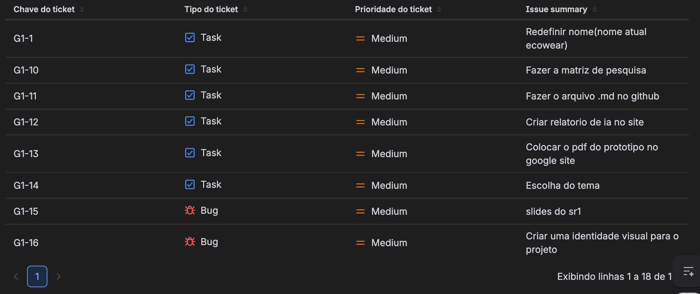
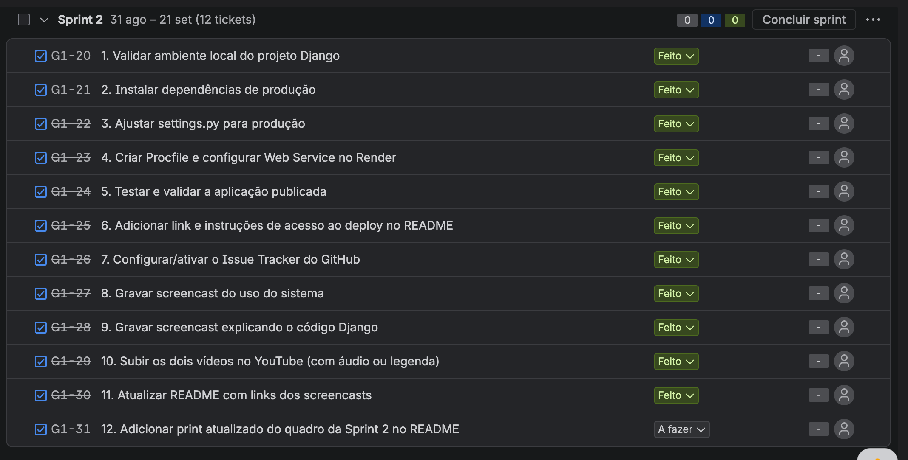
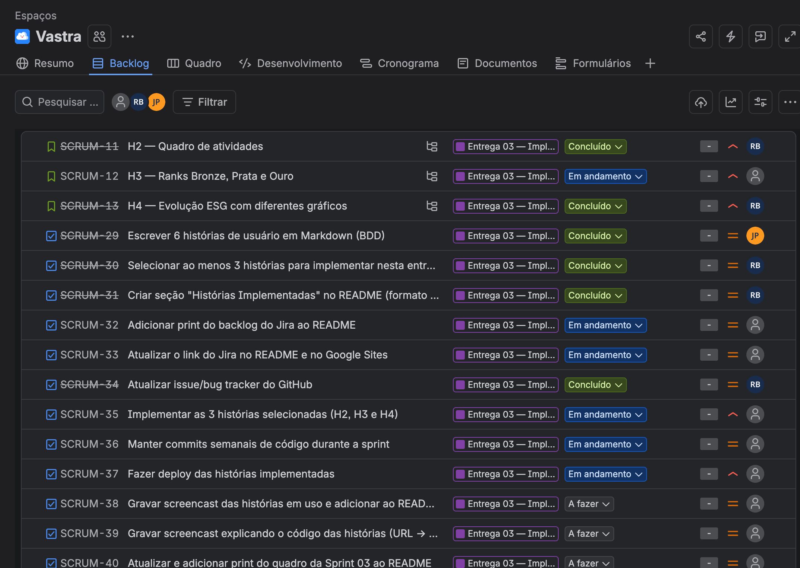
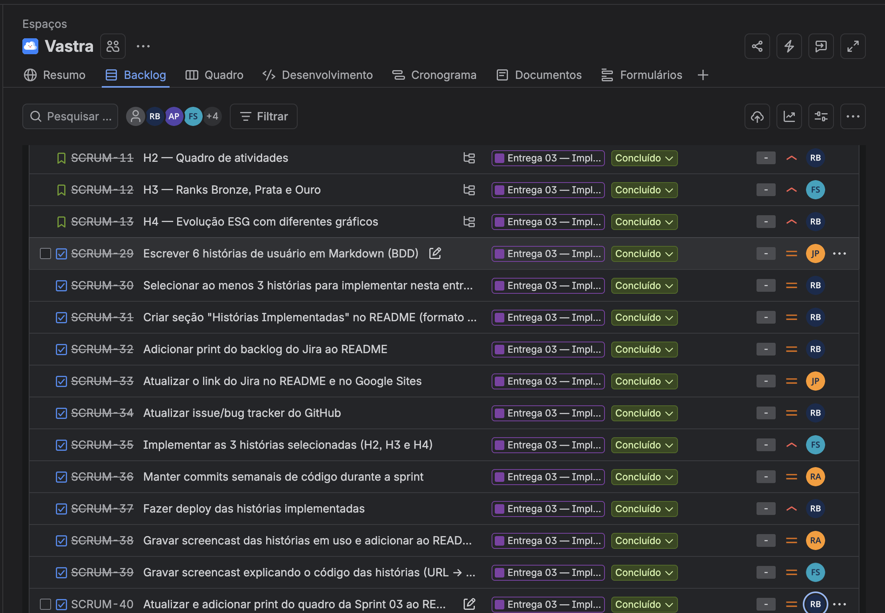
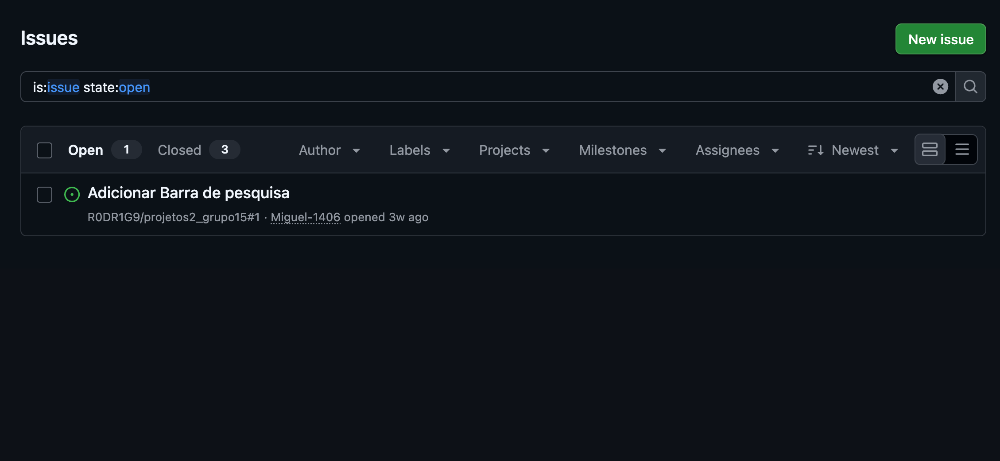
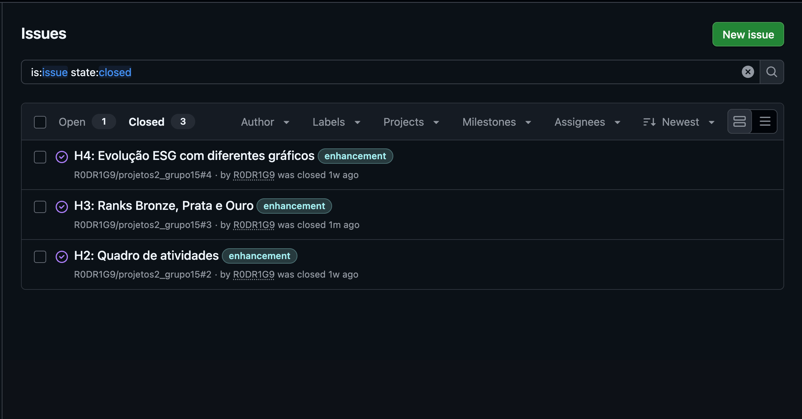

# [Vastra] - Plataforma de Gestão ESG para PMEs

[](https://github.com/R0DR1G9/projetos2_grupo15/actions/workflows/ci.yml)

## 📋 Descrição do Projeto

Plataforma web para pequenas e médias empresas acompanharem seus indicadores, metas e ações de sustentabilidade (ESG - Ambiental, Social e Governança) em um único painel centralizado, inspirada na análise de mercado de ferramentas como Paresi, ESG Business, Minha Pegada, Orkea e EcoVadis.

## 🧭 Páginas do site

| Página | URL | Descrição |
|---|---|---|
| Início (painel) | `/` | Painel com score ESG, ações em andamento e dica da semana; menu lateral com navegação |
| Diagnóstico | `/diagnostico/` | Lista de diagnósticos feitos; `/diagnostico/novo/` abre o formulário em 4 etapas (perfil da empresa + 23 perguntas de maturidade, de 0 a 4, adaptadas ao tipo de operação) |
| Resultado do diagnóstico | `/diagnostico/<id>/` | Nota geral e por pilar/subtema, pontos fortes e próximos passos priorizados, com botão para adicionar cada ação ao Plano de Ação |
| Metodologia e fontes | `/diagnostico/metodologia/` | Como o diagnóstico foi construído (GRI Têxtil/Vestuário, Higg FEM, OCDE, ISO 26000, B Impact, modelos de maturidade ESG), pesos, limitações e fontes por pergunta |
| Sobre o projeto | `/sobre/` | O que estamos construindo, para quem, e como chegamos até aqui |
| Quem somos | `/quem-somos/` | Integrantes da equipe |
| Fale conosco | `/contato/` | Formulário de contato (bug, sugestão, dúvida) - respostas ficam salvas no banco e são visíveis no `/admin/` |
| Quadro de atividades | `/atividades/` | Quadro com colunas de status (Aguardando início, Em andamento, Concluído) para as ações de sustentabilidade, com prazo e responsável em cada ação (H2 e H7) |
| Evolução ESG | `/evolucao/` | Gráficos de linha, barras e radar com a evolução das notas ESG entre diagnósticos (H4) |
| Ranking | `/ranking/` | Rank Bronze, Prata ou Ouro baseado na nota ESG geral (H3) |
| Rede social | `/social/` | Feed de publicações entre empresas, com comentários, curtidas, hashtags e perfis (H5) |
| Mensagens | `/mensagens/` | Conversas privadas entre empresas |
| Biblioteca | `/biblioteca/` | Vídeos e textos sobre ESG, com filtro por pilar (H6) |
| Notificações | `/notificacoes/` | Avisos de comentários, mensagens e prazos do Plano de Ação; o sino no topo mostra os não lidos (H7) |

## 👥 Equipe

- Rodrigo Barbosa
- Joao Miguel
- Arthur Siqueira
- Rafael Queiroz
- Fernando Sotero
- Joao Victor Moraes
- Paulo Andre
- Marina Pontes
- Ana Beatriz
- Maria Clara
- Daniel

## 📄 Documentação

- [Documento de Análise de Competidores](./relatório_de_análise_de_competidores.md) - benchmark com 5 concorrentes, pontos fortes/fracos e requisitos levantados
- [Histórias de Usuário](./historias.md) - 6 histórias no formato Como/Quero/Para, com cenários de validação em BDD (Dado/Quando/Então)
- [Como contribuir](./CONTRIBUTING.md) - como rodar o projeto, fluxo de branches e Pull Requests, testes e pipeline de CI

## ✅ Requisitos do Produto (não triviais)

1. **Matriz de setores ESG filtrável** - o sistema deve permitir visualizar e filtrar indicadores por categoria (Ambiental, Social, Governança/Econômico) e por "Todos", cruzando dados de diferentes frentes em uma única matriz.
2. **Painel de indicadores com meta e progresso** - o sistema deve calcular e exibir o percentual de atingimento de uma meta (ex: 60%) com barra de progresso, junto de métricas auxiliares (nº total de tarefas, % de tarefas em dia/TPR, status de faturamento ativo).
3. **Comparativo de desempenho por período** - o sistema deve gerar um gráfico de evolução (ex: linha temporal) comparando o desempenho do período atual com o anterior, calculando automaticamente a variação percentual (ex: +14%).
4. **Gestão de status de ações** - o sistema deve classificar e contabilizar ações em pelo menos três estados (em andamento, aguardando início, concluídas), permitindo atualização do status por meio de checkboxes.
5. **Acompanhamento de metas trimestrais de ações sustentáveis** - o sistema deve rastrear o progresso de ações sustentáveis planejadas versus realizadas dentro de um período trimestral (ex: 4/10 ações), exibindo o percentual concluído.

## 📊 Benchmark

Tabela comparativa disponível no [documento de análise de competidores](./relatório_de_análise_de_competidores.md).

## 📦 Entrega 04

### Histórias implementadas

**H5: Rede social entre empresas**
- Como gestor(a) de uma confecção, quero publicar novidades e comentar nas publicações de outras empresas, para trocar experiências de sustentabilidade com a comunidade.
- Página: `/social/`

**H6: Biblioteca de tutoriais e vídeos**
- Como gestor(a) de uma confecção, quero acessar uma biblioteca de vídeos e textos sobre ESG, filtrando por pilar (Ambiental, Social e Governança), para aprender o que cada pilar significa e como melhorar minha empresa.
- Página: `/biblioteca/`

**H7: Acompanhamento do Plano de Ação (prazos, responsáveis e notificações)**
- Como gestor(a) de uma confecção, quero definir prazo e responsável em cada ação do meu Plano de Ação e ser avisado sobre prazos próximos, comentários e mensagens, para não deixar nenhuma ação atrasar nem perder interações importantes.
- Páginas: `/atividades/` e `/notificacoes/`

### Testes de ponta a ponta (Selenium)

As três histórias têm testes E2E na pasta `e2e/` (9 cenários), que abrem um Chrome real e usam o sistema como o usuário.

| História | Cenário | Arquivo |
|---|---|---|
| H5 | Publicar no feed | `e2e/e2e_rede_social.py` |
| H5 | Comentar na publicação de outra empresa | `e2e/e2e_rede_social.py` |
| H5 | Publicação vazia não é publicada | `e2e/e2e_rede_social.py` |
| H6 | Listar conteúdos | `e2e/e2e_biblioteca.py` |
| H6 | Filtrar por categoria | `e2e/e2e_biblioteca.py` |
| H6 | Assistir a um vídeo | `e2e/e2e_biblioteca.py` |
| H7 | Criar ação com prazo e responsável | `e2e/e2e_plano_acao.py` |
| H7 | Ação atrasada avisa no sino | `e2e/e2e_plano_acao.py` |
| H7 | Comentário de outra empresa avisa e pode ser marcado como lido | `e2e/e2e_plano_acao.py` |

```bash
pip install -r requirements-dev.txt
python manage.py test e2e --pattern="e2e_*.py" --verbosity 2
```

### CI/CD

O pipeline em [`.github/workflows/ci.yml`](./.github/workflows/ci.yml) roda os testes unitários, depois os testes Selenium e, **somente se os dois passarem** em um push na `main`, aplica as migrações no Neon e publica no Vercel.

Etapas do pipeline: **Testes** (checagem do Django, migrações e testes unitários), **Testes E2E (Selenium)** e **Deploy na Vercel**. O deploy só roda depois que os dois primeiros passam.


- **Screencast do CI/CD:** [link do YouTube](#)

## 📦 Entrega 03

### Histórias implementadas

**H2: Quadro de atividades**
- Como gestor(a) de uma confecção, quero organizar minhas ações de sustentabilidade em um quadro com colunas de status, para acompanhar o que está aguardando, em andamento e concluído.
- Página: `/atividades/`

**H3: Ranks Bronze, Prata e Ouro**
- Como gestor(a) de uma confecção, quero ver um rank baseado na minha nota ESG geral, para entender meu nível de maturidade e ter uma meta clara.
- Página: `/ranking/`

**H4: Evolução ESG com diferentes gráficos**
- Como gestor(a) de uma confecção, quero ver a evolução das minhas notas em diferentes tipos de gráfico, para analisar meu progresso ao longo do tempo.
- Página: `/evolucao/`

## 🖼️ Quadro da Sprint

**Jira:** [Quadro do projeto Vastra](https://rodrigofds26.atlassian.net/jira/software/projects/SCRUM/boards/1) · [Backlog](https://rodrigofds26.atlassian.net/jira/software/projects/SCRUM/boards/1/backlog)

### Sprint 01



### Sprint 02



### Sprint 03 - Backlog (JIRA)



### Sprint 03 - Backlog finalizado



### Sprint 04


## 🐛 Issue Tracker

Bugs e pendências são registrados nas [Issues do repositório no GitHub](https://github.com/R0DR1G9/projetos2_grupo15/issues).

**Issues abertas**



**Issues fechadas** (histórias H2, H3 e H4 implementadas)



## 🚀 Deploy

- **URL em produção:** https://projetos2-grupo15.vercel.app
- **Como o deploy acontece:** a cada push na `main`, o pipeline de CI/CD roda os testes, aplica as migrações no banco de produção e publica no Vercel. Não é preciso fazer deploy manual.
- **Como rodar localmente:**
```bash
git clone https://github.com/R0DR1G9/projetos2_grupo15.git
cd projetos2_grupo15
python -m venv venv
source venv/bin/activate  # Windows: venv\Scripts\activate
pip install -r requirements.txt
python manage.py migrate
python manage.py runserver
```

## 🎥 Screencasts

### Funcionalidades anteriores (Entrega 02)

- **Uso do sistema:** [link do YouTube](https://youtu.be/2ni9VbnhRu0)
- **Explicação do código:** [link do YouTube](https://youtu.be/rq166RePr94)

### Novas funcionalidades - Entrega 03 (H2, H3 e H4)

Vídeos gravados apenas com as funcionalidades novas (Quadro de atividades, Ranking e Evolução ESG).

- **Uso do sistema e Explicação do código:** [link do YouTube](https://youtu.be/0OdchLhlkLc)

### Novas funcionalidades - Entrega 04 (H5, H6 e H7)

- **Uso do sistema em produção (URL visível):** [link do YouTube](#)
- **Testes Selenium (com áudio):** [link do YouTube](#)
- **CI/CD funcionando:** [link do YouTube](#)
- **Explicação do código (URL, view, template e model de cada história):** [link do YouTube](#)

## 🔗 Acesso ao Repositório

- **Repositório GitHub:** https://github.com/R0DR1G9/projetos2_grupo15
- **Como clonar:**
```bash
  git clone https://github.com/R0DR1G9/projetos2_grupo15.git
```

## 🛠️ Tecnologias (previstas)

- [x] Backend: Django 
- [x] Frontend: HTML/CSS
- [X] Banco de dados: SQLite (local) e PostgreSQL no Neon (produção)
- [x] Interface: Bootstrap 5
- [x] Gráficos: Chart.js (aba Evolução ESG)
- [x] Testes E2E: Selenium
- [x] CI/CD: GitHub Actions + Vercel

